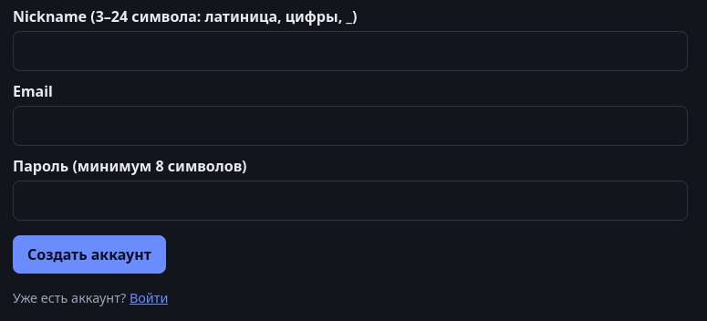
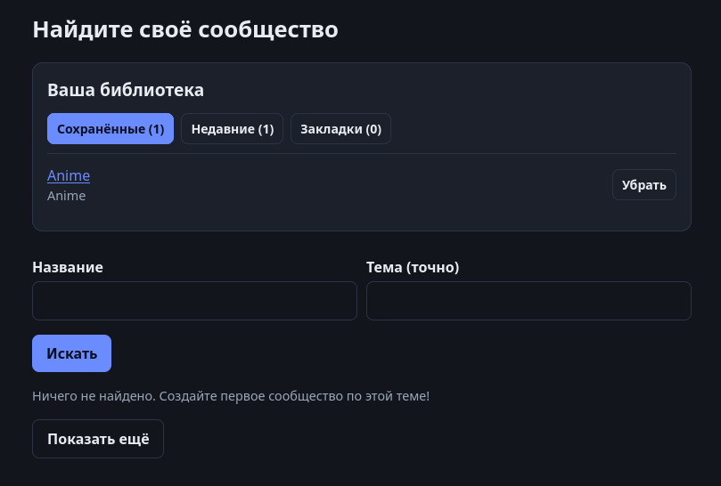
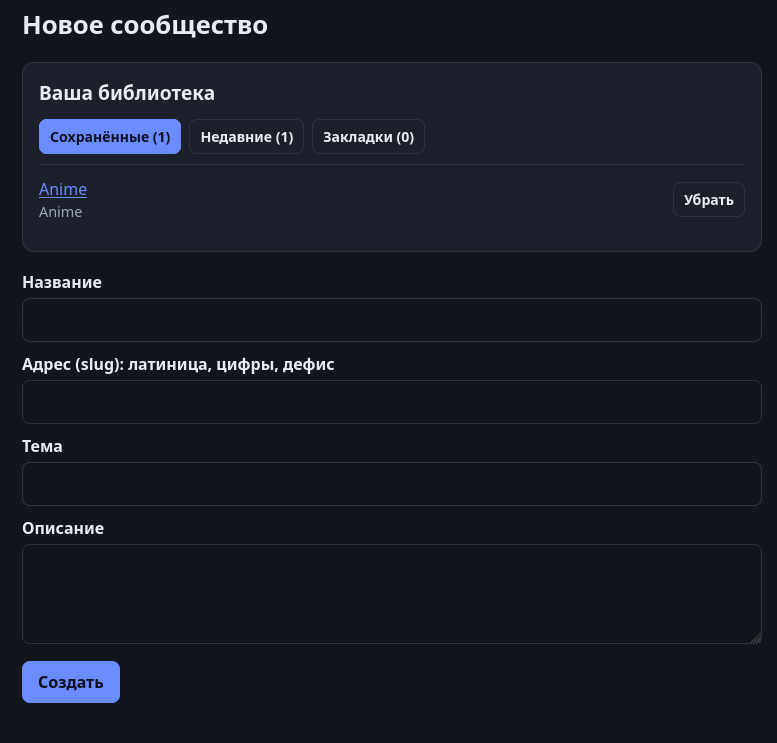
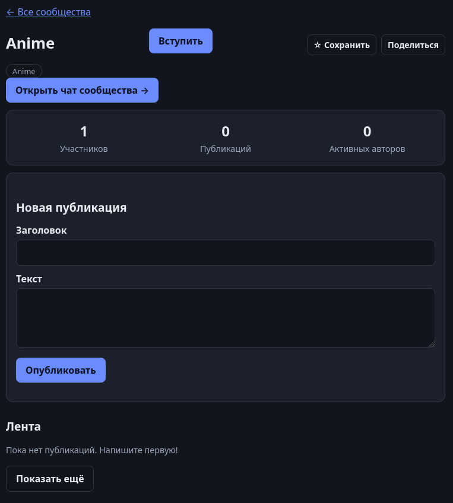
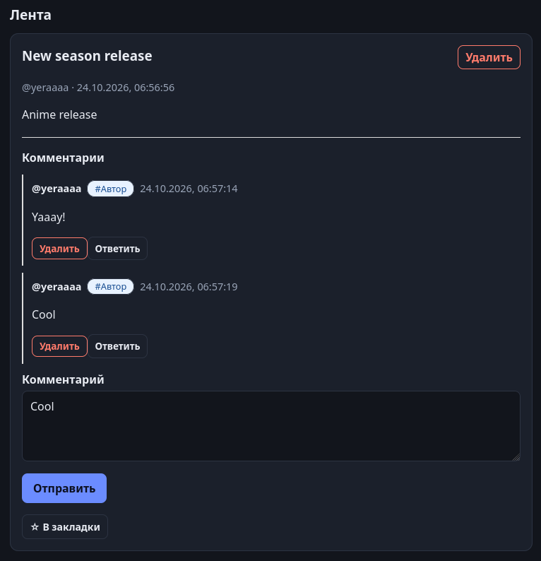
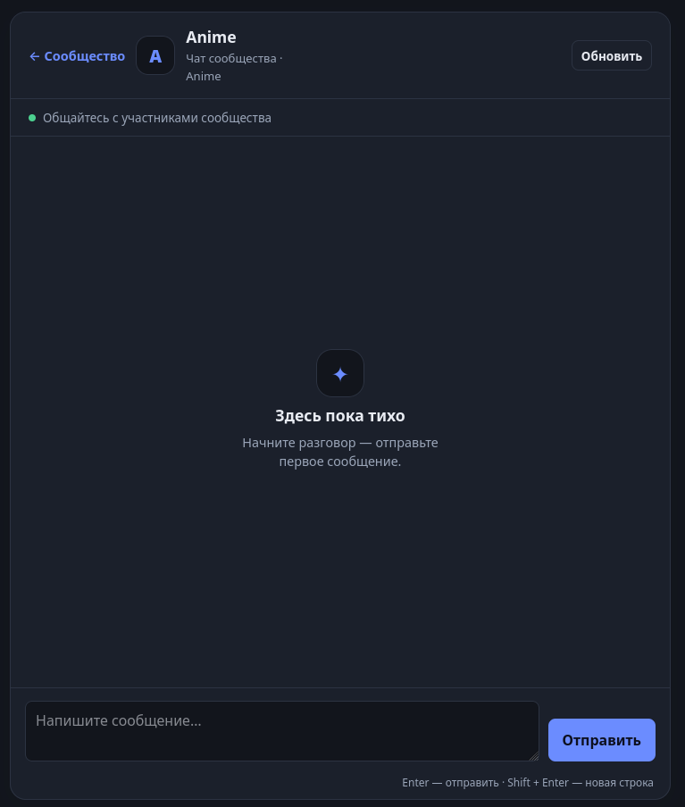

# UX Prototype

## 1. Purpose

This document presents the visual UX prototype of the Thematic Communities Platform.

The prototype is based on:

- the approved requirements specification;
- findings from potential-user research;
- the system context diagram;
- the use case diagram;
- the proposed component architecture.

The purpose of the prototype is to demonstrate the intended information architecture, main screens, navigation model, and key interaction patterns before the interface is finalized.

The visual screens documented here are prototype artifacts.

## 2. Prototype Scope

The current visual prototype covers the following key areas:
1. user registration;
2. community discovery;
3. community creation;
4. community membership and community overview;
5. publication creation;
6. persistent publication discussions;
7. comments and replies;
8. publication-author identification;
9. community chat.

The current prototype does not yet provide a dedicated visual screen for:
- moderator management;
- community role management;
- detailed account/profile settings;
- every validation and error state;
- final responsive/mobile layouts.

These areas remain part of later UX refinement where required by the approved requirements.

## 3. Main UX Principles

### 3.1 Community-Centered Interaction

The community is the primary organizational unit of the interface.

Users can:
- discover communities;
- open a community;
- join a community;
- view its persistent content;
- create publications;
- participate in discussions;
- open its dedicated chat.

### 3.2 Persistent and Quick Communication

A central UX decision is the separation between persistent publication-oriented communication and quick conversational communication.

Persistent interaction is represented through:
- publications;
- comments;
- replies.

Quick communication is represented through:
- a dedicated community chat.

This decision is directly related to the user-research finding that participants value both persistent information and rapid communication for different purposes.

### 3.3 Visible User Identity

User nicknames are displayed consistently in community interaction.

The publication author can also be identified when participating in the discussion of their own publication.

### 3.4 Explicit Community State

The interface exposes relevant community information such as:

- membership state;
- number of participants;
- number of publications;
- community topic;
- available community actions.

## 4. Screen P1 - User Registration

### Purpose

The registration screen allows a new user to create an account.

### Visible Elements

The prototype includes:

- nickname input;
- email input;
- password input;
- account-creation action;
- navigation to the authentication flow.

The nickname field explicitly communicates its initial formatting constraints.

### Related Requirements

- FR-01 - User Registration
- FR-02 - User Authentication
- NFR-01 - Authentication Security
- NFR-02 - Password Protection

### UX Notes

The registration form is intentionally focused on a small set of account information.

The interface provides a clear path for users who already have an account through the **Войти** link.

---

## 5. Screen P2 - Community Discovery

### Purpose

The discovery interface allows users to locate thematic communities.

### Visible Elements

The screen includes:
- the heading **Найдите своё сообщество**;
- the user's community library;
- saved communities;
- recently accessed communities;
- bookmarks;
- search by community name;
- search by exact topic;
- community search action;
- an empty search-result state.

### Related Requirements

- FR-05 - Community Discovery
- FR-04 - Community Membership

### UX Notes

The dedicated discovery page provides a clear route for users to locate communities without relying only on previously known links.

The prototype also demonstrates an empty state:

> Ничего не найдено. Создайте первое сообщество по этой теме!

This provides feedback instead of presenting an unexplained empty interface.

### Exploratory Elements

The following prototype controls are visible but are not currently defined as mandatory requirements in the approved requirements baseline:

- Saved communities;
- Recent communities;
- Bookmarks.

---

## 6. Screen P3 - Community Creation

### Purpose

The community-creation interface allows an authenticated user to create a thematic community.

### Visible Elements

The prototype includes:
- community name;
- URL slug;
- topic;
- description;
- create action.

The interface also keeps the user's community library visible above the form.

### Related Requirements

- FR-03 - Community Creation
- FR-13 - Community Ownership and Roles

### UX Notes

The form separates the human-readable community name from the URL-oriented slug.

The interface communicates the allowed slug format directly:

> латиница, цифры, дефис

This is useful because users receive input constraints before submitting the form.

After successful community creation, the creator is expected to become the initial Community Owner according to the approved requirements.

---

## 7. Screen P4 - Community Page

### Purpose

The community page acts as the primary entry point into a selected community.

### Visible Elements

The prototype includes:

- community title;
- community topic;
- join action;
- community chat access;
- participant count;
- publication count;
- active-author count;
- publication-creation form;
- publication feed;
- empty publication-feed state.

### Related Requirements

- FR-04 - Community Membership
- FR-06 - Publication Creation
- FR-07 - Community Publication Feed
- FR-11 - Community Chat
- FR-12 - Dedicated Community Chat Interface
- FR-13 - Community Ownership and Roles

### UX Notes

The screen demonstrates that persistent community content and quick chat belong to the same community while remaining different interaction areas.

Persistent content is presented directly on the community page.

Quick communication is accessed through the clearly visible:

> Открыть чат сообщества

action.

The empty feed state is also represented:

> Пока нет публикаций. Напишите первую!

This gives users a clear next action in a newly created community.

### Exploratory Elements

The prototype also contains:
- Save;
- Share.

---

## 8. Screen P5 - Publication Discussion

### Purpose

This screen represents persistent structured discussion around a publication.

### Visible Elements

The prototype demonstrates:
- publication title;
- publication author;
- publication timestamp;
- publication content;
- publication deletion for an authorized user;
- comments;
- replies;
- comment timestamps;
- reply actions;
- comment deletion;
- comment creation;
- publication bookmarking.

### Related Requirements
- FR-07 - Community Publication Feed
- FR-08 - Comments
- FR-09 - Replies
- FR-10 - Publication Author Identification
- FR-15 - User Content Deletion
- FR-16 - Consistent User Identity

### Publication Author Identification

The prototype includes the label:

> #Автор

when the publication creator participates in the discussion.

This visually satisfies the design intent of FR-10.

The label does not represent a separate system role.

It only identifies the relationship between a discussion participant and the publication currently being viewed.

### Discussion Structure

The visual hierarchy makes a distinction between:
1. the original publication;
2. comments;
3. replies to comments.

This supports the persistent and structured communication model identified during earlier research stages.

### Exploratory Elements

The **В закладки** action is present in the prototype but is not currently a mandatory requirement.

---

## 9. Screen P6 - Community Chat

### Purpose

The community chat provides quick conversational interaction between community participants.

### Visible Elements

The prototype includes:
- navigation back to the community;
- community identity;
- chat status indicator;
- manual refresh action;
- message history area;
- empty-chat state;
- message input;
- send action;
- keyboard interaction hint.

### Related Requirements

- FR-11 - Community Chat
- FR-12 - Dedicated Community Chat Interface
- FR-16 - Consistent User Identity

### Empty State

The prototype explicitly handles a community with no chat history:

> Здесь пока тихо

followed by:

> Начните разговор - отправьте первое сообщение.

This provides a meaningful starting state rather than leaving the interface blank.

### Quick Communication Model

The chat interface is intentionally different from publication discussion.

The publication interface emphasizes:
- topic;
- persistent content;
- comments;
- replies.

The chat interface emphasizes:
- conversational message flow;
- quick message creation;
- immediate community interaction.

The separation corresponds directly to findings from the project user research.

---

## 10. Main User Scenarios

### S1 - User Registration and Community Discovery

User Registration  
- Authentication  
- Community Discovery  
- Open Community

### S2 - User Joins a Community

Community Discovery  
- Open Community  
- Join Community  
- Access Community Content

### S3 - User Creates a Community

Authenticated User  
- Create Community  
- Enter Community Information  
- Submit  
- Become Community Owner

### S4 - Member Creates a Publication

Community Page  
- Enter Publication Title and Content  
- Publish  
- Publication Appears in Community Feed

### S5 - Member Participates in Persistent Discussion

Open Publication  
- Read Existing Comments  
- Create Comment  
- Reply to Comment

### S6 - Publication Author Participates in Discussion

Open Own Publication  
- Participate in Comments  
- Interface Displays Author Indicator

### S7 - Member Uses Quick Communication

Open Community  
- Open Community Chat  
- Read Chat History  
- Send Message

---

## 11. Visual User Flow

The main navigation relationships between prototype screens are documented separately in:

- `user-flow.mmd`;
- `user-flow.svg`.

The flow diagram complements the interface screenshots rather than replacing them.

Screenshots represent visual interface design.

The Mermaid diagram represents navigation and scenario flow.

---

## 12. Requirements Traceability

| Prototype Area | Requirement Coverage |
|---|---|
| Registration | FR-01 |
| Authentication entry point | FR-02 |
| Community discovery | FR-05 |
| Community creation | FR-03 |
| Community membership | FR-04 |
| Community page | FR-04, FR-07, FR-11, FR-12 |
| Publication creation | FR-06 |
| Publication feed | FR-07 |
| Comments | FR-08 |
| Replies | FR-09 |
| Author indicator | FR-10 |
| Community chat | FR-11, FR-12 |
| Community ownership | FR-13, partially represented through creation flow |
| Own-content deletion | FR-15 |
| Consistent nickname | FR-16 |

### Requirements Not Yet Fully Visualized

The current screenshot set does not fully visualize:
- FR-13 role-management interface;
- FR-14 moderation interface.

These requirements remain part of the approved requirements specification.

Their absence from the current visual prototype is documented as a prototype limitation rather than being hidden or artificially represented.

---

## 13. Relationship to User Research

### Persistent Information

Project research identified recurring difficulties with useful information becoming difficult to retrieve in high-volume communication environments.

The prototype therefore provides persistent publication-oriented content rather than relying exclusively on chat.

### Persistent and Quick Communication

Both interaction types were valued in the project research.

The prototype therefore provides:
- a persistent publication and discussion interface;
- a dedicated community chat interface.

### Organization

Publication discussions distinguish:
- publication;
- comments;
- replies.

This creates a more explicit hierarchy than a continuous message stream.

### Discovery

A dedicated community discovery interface provides search by community name and topic.

### Onboarding

Empty states guide users when:
- no community is found;
- a community has no publications;
- a community chat has no messages.

These design decisions remain subject to later usability evaluation.

---

## 14. Prototype-Specific Functionality

Some elements visible in the prototype extend beyond the mandatory approved requirements.

Examples include:
- saved communities;
- recent communities;
- bookmarks;
- save-community action;
- share-community action;
- active-author statistics.

These elements demonstrate possible UX directions.

They must not be treated as mandatory system requirements unless they are formally added to the requirements specification through the project change process.

This distinction prevents the visual prototype from silently changing the approved project scope.

---

## 15. Interaction States Represented

The current visual prototype provides examples of several useful system states.

### Empty Community Search

The user receives an explicit no-results message.

### Empty Publication Feed

The community page encourages creation of the first publication.

### Empty Chat

The chat interface encourages the first message.

### Existing Discussion

The publication view demonstrates a populated discussion containing comments and replies.

### User-Owned Content

Deletion controls demonstrate how actions may differ based on content ownership.

Additional states such as authentication errors, permission failures, connection failures, and moderation confirmation remain to be designed or validated later.

---

## 16. Prototype Limitations

The current prototype is not a final visual design.

The following areas remain incomplete or subject to change:
- final branding;
- final color system;
- responsive mobile layouts;
- accessibility validation;
- dedicated login screen in the current screenshot set;
- detailed moderator interface;
- community role-management interface;
- all validation states;
- all error states;
- loading states;
- chat reconnection behavior;
- final wording and localization.

The current interface primarily uses Russian labels.

Final localization requirements are not established by this prototype.

---

## 17. Prototype Status

| Area | Status |
|---|---|
| Registration | Visually prototyped |
| Authentication entry point | Visually represented |
| Community discovery | Visually prototyped |
| Community creation | Visually prototyped |
| Community membership | Visually prototyped |
| Community overview | Visually prototyped |
| Publication creation | Visually prototyped |
| Publication discussion | Visually prototyped |
| Comments | Visually prototyped |
| Replies | Visually prototyped |
| Author identification | Visually prototyped |
| Community chat | Visually prototyped |
| Empty states | Partially prototyped |
| Moderation UI | Not yet visually prototyped |
| Role-management UI | Not yet visually prototyped |
| Usability evaluation | Planned |
| Final visual design | Not finalized |
| Current repository implementation | Not claimed by this document |

---

## 18. Next Steps

The visual prototype will provide input to:

- the verification and evaluation plan;
- usability testing;
- later interface refinement;
- implementation;
- supervisor feedback.

Future prototype changes should be based on:

- usability evidence;
- approved requirement changes;
- implementation constraints;
- supervisor feedback.
